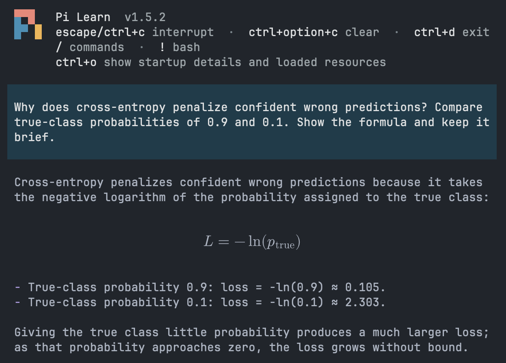
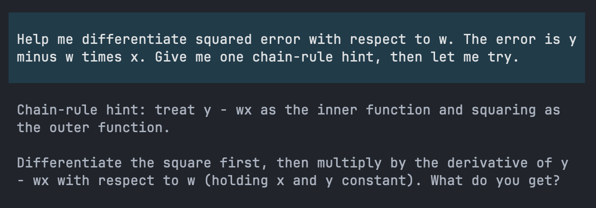

# Pi Learn

A tutoring setup for the Pi terminal agent. Ask for a worked example, check your reasoning, or get one hint at a time. Read typeset LaTeX right in Herdr or a compatible terminal.

[Install](#install) · [Try a prompt](#try-a-prompt) · [Use in Herdr](#use-in-herdr)



*A real Pi Learn session in Herdr. TFormula renders the display equations.*

## Install

You'll need Node.js 22.19 or newer with npm. [Download the ZIP](https://github.com/IsaacAnwar/pi-learning-config/archive/refs/heads/main.zip), extract it, and open a terminal in the extracted folder. If you use Git, you can clone it instead.

```sh
git clone https://github.com/IsaacAnwar/pi-learning-config.git
cd pi-learning-config
```

### macOS, Linux, or WSL

```sh
sh ./install.sh
~/.local/bin/pi-learn
```

Keep the extracted folder so the per-user launcher can find it. To run from the checkout, use `npm run setup` once and `npm start` to launch.

### Native Windows

In [Windows Terminal with Git for Windows](https://docs.pi.dev/latest/windows), run these commands in PowerShell.

```powershell
npm.cmd run setup
npm.cmd start
```

In your first session, use `/login` to connect a supported provider and `/model` to select a model.

<details>
<summary>Install and dependency details</summary>

Both installers use the same npm lockfile and skip dependency lifecycle scripts. Linux builds the locked `node-pty` dependency separately when needed for TFormula. The build requires Python 3, make, and a C/C++ toolchain, such as `python3` and `build-essential` on Debian or Ubuntu.

Setup uses Pi's usual settings, sessions, and authentication directory, or the directory set with `PI_CODING_AGENT_DIR`. Use an absolute or home-relative path for that override if you launch Pi from different directories. The dark theme, streaming Mermaid, and shortcut defaults are seeded when the corresponding settings files are absent.

</details>

### Install with a coding agent

Open the checkout in Claude Code and run `/setup-pi-learn`. Other coding agents can follow [AGENTS.md](AGENTS.md). To have an agent download and set it up for you, give it this prompt.

> Set up Pi Learn from https://github.com/IsaacAnwar/pi-learning-config. Follow the repository's AGENTS.md and verify that it starts in a standalone terminal.

## Try a prompt

`pi-learn` loads the [learning skill](skills/learn/SKILL.md) at startup. It guides Pi to answer first, explain the mechanism, and add a worked example or a check for understanding when useful.

**Work through a formula**

> Why does cross-entropy penalize confident wrong predictions? Compare true-class probabilities of 0.9 and 0.1. Show the formula and keep it brief.

**Get one hint**

> Help me differentiate squared error with respect to w. The error is y minus w times x. Give me one chain-rule hint, then let me try.



**Check your reasoning**

> My classifier has 95% accuracy on a dataset with 95% negatives. Compare it with a classifier that always predicts negative. Show both class recalls and explain what I can conclude.

## Use in Herdr

Use the full launcher path printed by `sh ./install.sh` as the value in `programs.pi.run` in `~/.config/herdr-app/programs.json`.

```json
{
  "programs": {
    "pi": {
      "run": ["<full launcher path printed by the installer>"]
    }
  }
}
```

Merge this entry into the existing JSON, then start a new Pi session from Herdr's agent menu. The wrapper uses Pi's regular terminal mode so Herdr can display the equation images.

## Terminal math

TFormula renders equation images on macOS and Linux in terminals with compatible Kitty graphics, such as Herdr, Ghostty, Kitty, and WezTerm. Pi's built-in renderer handles native Windows, tmux, and other terminals. Set `PI_LEARN_MATH=0` when launching to use Pi's built-in renderer. Print, JSON, and RPC modes run directly through Pi.

## Customize

- Edit [the learning skill](skills/learn/SKILL.md) and start a new session to pick up changes.
- On an existing Pi installation, you can install just the skill with `pi install git:github.com/IsaacAnwar/pi-learning-config` and invoke it with `/skill:learn`.
- The original header and the `/clear`, `/exit`, and `/session-usage` extensions are in [the optional Herdr package](config/extras). Install it with `~/.local/bin/pi-learn install "$PWD/config/extras"` from this checkout if those commands aren't already installed. The [Open TUI preferences](config/open-tui.json) are for the optional `pi-open-tui` package.
- For the original add-ons, add the package sources from [the Herdr settings example](config/settings.herdr.json) to your Pi settings. Pi installs the configured packages on the next launch.
- In a Git checkout, run `git pull --ff-only` and repeat the setup command to update. For a newer ZIP extracted to a new folder, run the npm setup and start commands from that folder.

[Pi documentation](https://docs.pi.dev/) · [TFormula](https://github.com/mikewang817/TFormula) · [Original Herdr configuration](https://github.com/IsaacAnwar/herdr-config)
